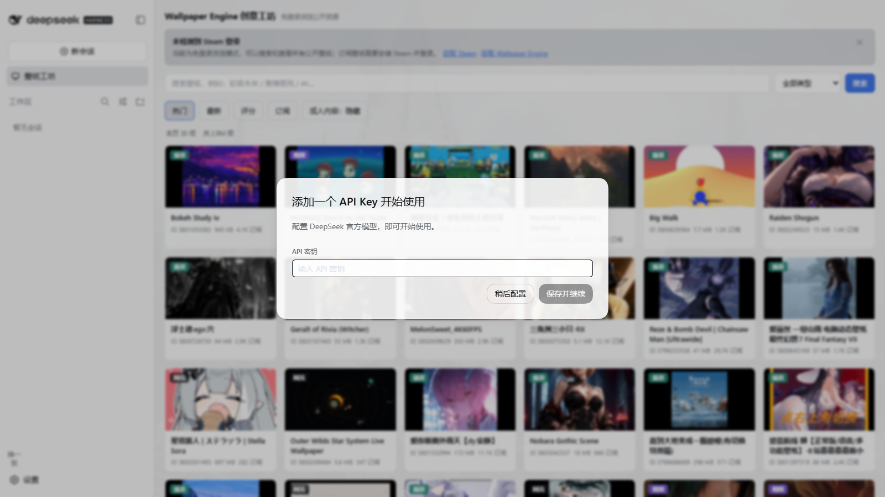
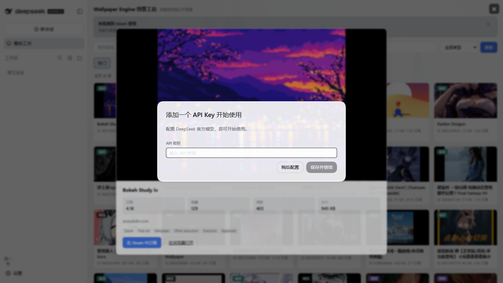

# dsh-wallpaper-engine

把 Wallpaper Engine 的创意工坊接进 DSH：浏览、搜索、下载壁纸，然后在 DSH 里用起来。





左侧栏的「壁纸工坊」图标点开是一整面网格：搜索、类型筛选、四种排序、总页数与跳页，
每张卡片点开是详情弹窗，订阅按钮唤起 `steam://` 交给 Steam 客户端。

## 装之前请先看这里

**这个插件是 Wallpaper Engine 与 DSH 之间的连接器。浏览和搜索开箱即用，但要让壁纸真正
铺到 DSH 上，有三件事缺一不可：**

| 条件 | 为什么 |
| --- | --- |
| **① Steam 客户端** | 下载创意工坊内容需要 Steam 会话；Wallpaper Engine 本身也只能从 Steam 安装 |
| **② 登录 Steam 账号** | Steam 对匿名下载请求的回答是 `{"success":15,"message":"No user"}` |
| **③ Wallpaper Engine（付费，约 ¥19）** | 唯一能渲染 Scene 场景壁纸、并把壁纸铺到桌面上的程序 |

插件会**自动检测这三项**并在面板顶部逐条标出还缺哪个 —— 不会在你只差一步的时候让你
重装已经装好的东西。

**只浏览不下载的话，上面三项一个都不需要。** 搜索、筛选、看详情、看订阅数全部免登录。

## 它做什么

| 能力 | 状态 |
| --- | --- |
| 浏览热门 / 最新 / 评分 / 订阅榜 | ✅ 免登录 |
| 关键词搜索 | ✅ 免登录 |
| 类型筛选（场景 / 视频 / 应用 / 网页 / 动漫 / 游戏等 14 类） | ✅ 免登录 |
| 翻页 + 总条数 + 总页数 + 跳页 | ✅ 免登录 |
| 详情弹窗（订阅数 / 收藏 / 浏览 / 大小 / 标签 / 简介） | ✅ 免登录（匿名 WebAPI） |
| 三项前置条件检测 + 逐条引导 | ✅ 读本地 Steam 文件 |
| `steam://` 唤起 Steam 客户端 | ✅ 已登录时直达；未满足时弹引导 |
| 缩略图 | ✅ 浏览器直连 Steam CDN |
| 下载壁纸到本地 | 🚧 开发中（需要 ①②③） |
| 在 DSH 中使用壁纸 | 🚧 开发中（视频/图片类可行，见下） |
| 成人内容过滤 | ⚠️ 见下 |

## 能力边界（先说清楚，免得装完失望）

### 场景类壁纸浏览器渲染不了

Wallpaper Engine 有两类壁纸，DSH 是网页界面，能处理的程度完全不同：

| 类型 | DSH 能做什么 |
| --- | --- |
| **视频 / 图片类**（mp4 / webm / jpg） | ✅ 可以直接当背景播放 |
| **场景类 Scene**（`.pkg`） | ❌ **只能由 Wallpaper Engine 自己渲染** |

场景类是一个包含着色器和渲染管线的私有二进制包。这不是工程量问题——**浏览器原理上
无法还原**。这类壁纸最多做到"下载下来交给 WE"，或者由 WE 导出一张静帧给你看。

### 本插件不碰你的账号凭据

它只读 `loginusers.vdf` 里的**昵称**来判断"有没有登录"，**不读令牌、不读 `ssfn` 文件、
不发起任何需要登录的请求**。下载由 Steam 客户端自己完成。

### 成人内容

Steam 用 `Adult only` 标签标记受众，而这个标签**匿名请求不返回**（实测匿名访问
`requiredtags=Adult` 得到 0 条）。所以面板上的开关是按标签过滤：逻辑正确，但匿名状态下
大部分成人条目标签本身不可见。

## 安装

```sh
dsh plugin --profile web add dsh-wallpaper-engine
```

或从仓库直接装：

```sh
dsh plugin --profile web add github:HaydenSmith1121/dsh-wallpaper-engine
```

装完需要重启 DSH，或让 profile 的 `patchReload: live` 生效。

## 代理

`steamcommunity.com` 在很多网络下无法直连（DNS 污染、路由被过滤）。**实测
TUN 模式是可靠的解法**：仅开系统代理时，Clash 的 `fake-ip` 会让
`steamcommunity.com` 解析到 `198.18.x.x`，而 DSH 自己的 web 服务会把这个保留
网段判定为非公网地址并拒绝请求。

本插件的宿主半**自带 CONNECT 隧道**（见 `src/host/net.js`），不依赖 Node 的
`fetch`，也不要求进程带 `--use-env-proxy`：

- 面板里填了代理 → 用它；
- 没填 → 回落到进程环境的 `HTTPS_PROXY` / `ALL_PROXY` 等。

实测在 7897 端口、TUN 模式下的表现：首次页面 10/10 成功，搜索稳定返回 30 条。

## 配置

配置写在 `$DSH_HOME/storages/dsh-wallpaper-engine/config.json`，不写进 DSH 的
共享 `settings.yaml`——那是产品自己的文档，第三方插件的代理地址不该混进去。

| 字段 | 默认 | 说明 |
| --- | --- | --- |
| `sort` | `trend` | 默认排序 |
| `showAdult` | `false` | 成人内容开关 |
| `proxy` | `""` | 代理地址；留空读环境变量 |

## 开发

```sh
npm test           # 26 个用例
npm run build      # src/ → lib/
npm run build:check # CI 门禁：lib/ 与 src/ 是否一致
npm run pack       # 打成可安装的 tgz
```

`lib/` 是**提交进仓库**的：这个包可以从 git 直接安装，而 git 安装不会跑本仓库
的构建脚本。`build:check` 是让提交的那份老实的手段。

宿主半是源码的直接拷贝（纯 ESM，无打包）；客户端半被包进 DSH 的
`window.__ModuleLoader__` 外壳，共享词汇内联在前面。

## 结构

```
src/index.js            宿主半入口：注册 /plugins/dsh-wallpaper-engine
src/host/net.js         带 CONNECT 隧道的 HTTP（无依赖）
src/host/store.js       配置文档（原子写）
src/host/workshop.js    创意工坊抓取与解析
src/host/steam.js       读取 loginusers.vdf 报告登录态
src/host/routes.js      路由分发
src/shared/constants.js 两半共用：URL 构造、HTML 解析、配置规范化
src/client.js           侧栏面板
```

## 许可

MIT
